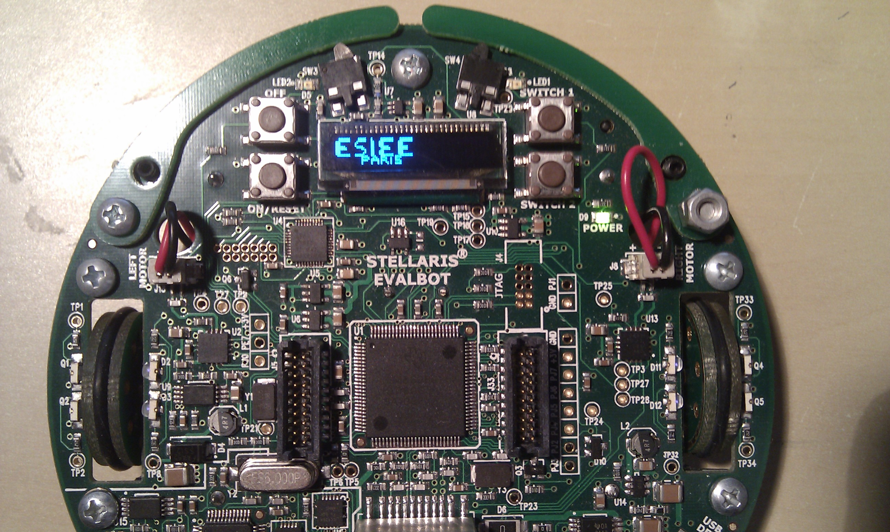

# Contexte
Ce projet m'a été proposé dans le cadre de ma formation d'ingénieur à ESIEE Paris, en particulier dans le cours intitulé "Programmation et systèmes à base de microprocesseurs". Dans le cadre de ce cours, nous avons étudié les notions de base relatives au fonctionnement et à la programmation du microprocesseur ARM Cortex M3. Afin de valider nos compétences acquises au fil de ce cours, nos professeurs nous ont proposés d'imaginer en binôme un projet utilisant le robot Evalbot fourni par l'école. Nos seules contraintes étaient d'exploiter les trois principaux type de périphérique du robot : 
* les LEDs
* les moteurs
* les boutons de type "switch"/"bumper"

# Description
Avec mon binôme, nous avons décidé de développer un programme permettant d'encoder toutes les lettres de l'alphabet latin dans la mémoire du robot afin qu'il puisse ensuite les représenter dans l'espace en deux dimensions par ses déplacements. Pour réaliser notre programme nous disposions exactement des périphériques suivants : 
* 2 LEDs vertes
* 2 boutons poussoirs de type "bumper"
* 2 boutons poussoirs de type "switch"
* 2 roues motrices

Pour plus de détails sur le fonctionnement de notre programme, vous pouvez consulter le [rapport du projet](Alphabot%20rapport%20final.pdf)

# Vidéo de test

Ne disposant plus du robot et n'ayant pas de vidéo représentant l'exécution du programme final sur notre robot, voici néanmoins un extrait vidéo d'un test effectué au cours de la phase de développement de notre programme, qui représente l'exécution d'une des instructions de notre programme ordonnant au robot de faire un quart de tour.

   
